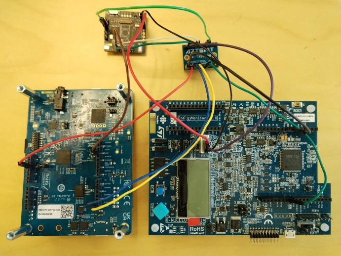
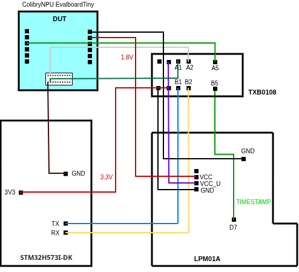

# Asygn ColibryNPU MLPerf Tiny Benchmark v1.4

This benchmark runs on the **ColibryNPU EvalboardTiny** evaluation board (available in preview upon request). The ColibryNPU chip is a RISC-V microcontroller featuring an ultra-low-power neural network accelerator optimized for CNN inference.

---
## 📦 Quantization and Model Compilation

Asygn provides the **ColibryNPU SDK**, a toolset for application development, model quantization, and compilation. The SDK quantizes weights and activations to unsigned 8-bit integers (INT8).

The compilation process:
1. Parses a trained model (TensorFlow, TFLite, PyTorch, etc.).
2. Applies **post-training quantization (PTQ)**.
3. Generates an **NNPA bitstream file** containing all information required for hardware execution.

Use the **NNPA Compiler** (included in the SDK) for this process.

Pre-compiled models for each benchmark are provided at: `code/<mode>/<benchmark>/<benchmark>_bitstream.nnpa`

**Path parameters:**
- `<mode>`: `colibryNPU_P1_300MHz` or `colibryNPU_P1_40MHz`
- `<benchmark>`: `ad`, `ic`, `ic2`, `kws`, or `vww`

---

## 💻 Application Binaries

Pre-compiled binaries for each benchmark are available in: `code/<mode>/<benchmark>/`


Two versions are provided:
- `*.bin` — For direct loading into the **ColibryNPU system SRAM**.
- `*_flash_copy.bin` — For loading into **flash memory**.

---

## 🔧 Hardware Setup

Measurements were performed using the [recommended MLCommons Runner setup](https://github.com/mlcommons/tiny/tree/master/benchmark/runner).



*Equivalent schematic:*
  


---
## ▶️ Running a Benchmark

### 1. Program the Board
1. Navigate to `code/tools/`
2. Follow the `README.md` instructions to program the board for your selected **mode** and **benchmark**.
   > **Note:** Programming requires connecting the **EvalboardTiny** to the **ColibryProbe** board (the dedicated USB programmer for this hardware).
  For the benchmark, the "toflash" programming should be used, because the power of the DUT board can be removed while plugging it to the rest of the hardware.

### 2. Execute the Benchmark
From the runner repository, run:
```sh
python main.py \
  --dataset_path=/path/to/datasets/ \
  --test_script=code/<mode>/tests_energy.yaml \
  --device_list=code/<mode>/devices.yaml \
  --mode=e
```

The required YAML files are provided in `code/<mode>/`.